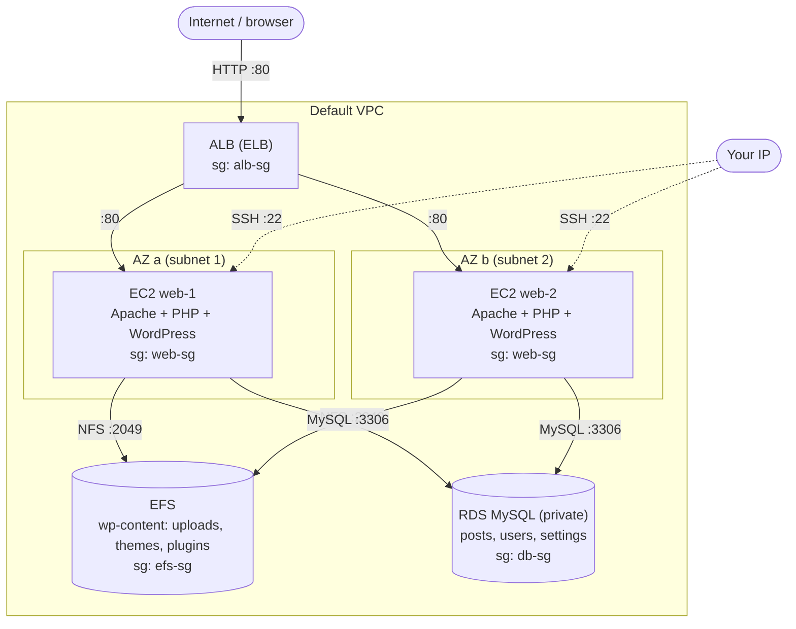

# Lab 01: WordPress on AWS (ELB + RDS + EFS + 2×EC2)

Deploys WordPress to AWS using only the AWS CLI. Each resource is created by
its own script in [`scripts/`](scripts/), and the [`Makefile`](Makefile) runs
them in the right order.



| Security group | Attached to | Allows in |
|---|---|---|
| `alb-sg` | Load balancer | 80 from the internet (`0.0.0.0/0`) |
| `web-sg` | Both web servers | 80 from `alb-sg`, 22 from your IP |
| `efs-sg` | EFS mount targets | 2049 from `web-sg` |
| `db-sg` | RDS | 3306 from `web-sg` |

Each component gets its own group so it opens only the port it serves, and
only to the tier in front of it. A single shared group would apply every rule
to every member: the web servers would take port 80 straight from the
internet (bypassing the load balancer), and RDS and EFS would accept
connections from the load balancer too. Rules use another group as the source
(for example `db-sg` allows 3306 from `web-sg`), so a replaced or added web
server gets access as soon as it carries `web-sg`, whatever its IP.

## Layout

| Path | Purpose |
|---|---|
| `Makefile` | Entry point, one target per step |
| `config.env` | Defaults (region, names, sizes). Override with env vars, `make VAR=…`, or `.env` |
| `scripts/lib/common.sh` | Shared config, resource names, logging, wait, and the save/load of IDs in `.state/` |
| `scripts/00-network.sh` | Picks the default VPC and two public subnets in different AZs |
| `scripts/01-security-groups.sh` | Creates and attaches the firewall rules (security groups) |
| `scripts/02-efs.sh` | Creates the network filesystem (EFS) and a mount target per subnet |
| `scripts/03-rds.sh` | Creates the MySQL database (RDS) |
| `scripts/04-keypair.sh` | Creates the SSH key pair (saved to `.state/`) |
| `scripts/05-ec2.sh` | Creates the two web-server VMs with the WordPress bootstrap as user-data |
| `scripts/06-elb.sh` | Creates the load balancer (ALB), target group and listener |
| `scripts/07-wordpress-install.sh` | Runs the WordPress installer through the ALB |
| `scripts/verify.sh`, `status.sh`, `ssh.sh`, `destroy.sh` | Check, inspect, log in, tear down |
| `wordpress/bootstrap.sh` | Runs on each VM at first boot (see below) |
| `.state/` (git-ignored) | Discovered network IDs, generated secrets, SSH key, rendered user-data |

## Requirement → implementation

| Requirement | Where |
|---|---|
| Create a load balancer (ELB) | `make elb` → `06-elb.sh` (Application Load Balancer, HTTP :80) |
| Create a MySQL database (RDS) | `make rds` → `03-rds.sh` (`db.t3.micro`, not publicly accessible) |
| Create a network filesystem (EFS) | `make efs` → `02-efs.sh` (encrypted, mount target in each AZ) |
| Create and attach firewall rules | `make security-groups` → `01-security-groups.sh` |
| Create two VMs (EC2) | `make ec2` → `05-ec2.sh` (`web-1`, `web-2` in different AZs) |
| Mount the EFS | `bootstrap.sh` step 1: `amazon-efs-utils`, TLS mount on `/var/www/html/wp-content`, persisted in `/etc/fstab` |
| Install Apache and PHP | `bootstrap.sh` step 2 (`httpd`, `php-fpm`, `php-mysqlnd`, …) |
| Download and extract latest WordPress | `bootstrap.sh` step 3 (`wordpress.org/latest.tar.gz`) |
| Configure WordPress to use RDS | `bootstrap.sh` step 4 writes `wp-config.php` with the RDS endpoint |
| Start Apache | `bootstrap.sh` step 6 (`systemctl enable --now php-fpm httpd`) |
| Install the WordPress instance | `make install` → `07-wordpress-install.sh` (posts the install form via the ALB) |
| Access the WordPress instance | `make verify`, then open the printed URL |

Both VMs share the same database, the same `wp-content` on EFS, and the same
authentication salts, so it doesn't matter which one the ALB picks: a user
stays logged in, and uploads are visible from both.

## Usage

Prerequisites: AWS CLI v2 configured (`aws configure` or `AWS_PROFILE`),
`make`, `curl`, `openssl`, `ssh`.

```bash
cd lab_01
make help            # list targets
make up              # create everything + install WordPress (~15 min, RDS is the slow part)
make verify          # hit the ALB several times; X-Served-By shows web-1/web-2 alternating
make seed            # insert sample posts (wordpress/seed-posts.tsv) into RDS via WordPress
make db-check        # read them back from each VM + RDS CloudWatch metrics
make status          # state of every resource
make ssh N=2         # SSH into web-2
make logs N=1        # bootstrap log of web-1
make destroy         # delete every AWS resource (asks for confirmation; YES=1 skips it)
make cleanup         # same as destroy, and also wipe local .state/ (SSH key, secrets)
```

Steps can also be run one at a time, in order (`make network`,
`make security-groups`, `make efs`, `make rds`, `make keypair`, `make ec2`,
`make elb`, `make install`). The scripts only create: they assume nothing from
this lab exists yet, and each one saves the IDs it created to
`.state/resources.env` for the next one. If a step fails halfway, run
`make destroy`, then `make up` again.

### WordPress login

| | Value |
|---|---|
| Admin URL | `http://<ALB DNS name>/wp-admin/` (printed by `make up` and `make verify`) |
| Username | `admin` (`WP_ADMIN_USER` in `config.env`) |
| Password | Random, generated on your machine the first time you run `make up` |

The password is never committed. It is printed at the end of `make up` and
saved as `WP_ADMIN_PASSWORD` in `.state/secrets.env` (git-ignored). To see it
again:

```bash
grep WP_ADMIN_PASSWORD .state/secrets.env
```

Each teammate who deploys from their own machine gets their own password. The
same password is reused on later deployments until `.state/` is deleted
(`make clean` or `make cleanup`), which generates a new one on the next
`make up`.

To choose the username or password yourself, set them in `.env` before the
first `make up`:

```bash
WP_ADMIN_USER=admin
WP_ADMIN_PASSWORD=choose-a-strong-password
```

A `WP_ADMIN_PASSWORD` set after `.state/secrets.env` exists has no effect:
the saved one wins. To start over with new secrets, run `make cleanup` (it
deletes the AWS resources first). Don't run `make clean` while the stack is
up: it also deletes the SSH key and the database password RDS is using. WordPress hashes
the password into the RDS database at install time, so changing it after
install means changing it in *wp-admin → Users*, not in these files.

## Notes

- **Cost.** The ALB, RDS, EFS and two EC2 instances are billed by the hour
  (only partly covered by the free tier). Run `make destroy` when you are done.
- **Region.** Taken from `AWS_REGION` (shell, `make AWS_REGION=…`, or `.env`),
  then `AWS_DEFAULT_REGION`, then the region of your AWS CLI profile
  (`aws configure get region`), and finally `ap-southeast-2` (Sydney). Each
  teammate can therefore deploy in their own account's region. `make check`
  prints the region it will use.
- **Secrets.** The DB password and salts are passed to the VMs through
  user-data, which anyone with `ec2:DescribeInstanceAttribute` can read. That's
  fine for a lab; production would use Secrets Manager or SSM Parameter Store.
- **HTTP only.** No TLS certificate or domain is configured.
- To re-create a VM with a fresh bootstrap, terminate it in the console (or
  `aws ec2 terminate-instances`) and run `make ec2 elb` again.
