# Lab 01 Report: Deploying WordPress on AWS

**Course:** Cloud Computing, Master of Information Systems, University of Science (VNU-HCM)  
**Instructor:** Dr. Ngô Huy Biên

| Student ID | Full Name | Email |
|---|---|---|
| 25C12034 | Nguyễn Đăng Quang | 25C1203455@student.hcmus.edu.vn |
| 25C12010 | Trần Kiến Quốc | 25C1201085@student.hcmus.edu.vn |
| 25C12003 | Phan Trần Khanh | 25C1200330@student.hcmus.edu.vn |
| 25C12031 | Dương Tấn Huỳnh Phong | 25C1203199@student.hcmus.edu.vn |
| 25C12029 | Đào Khoa Nguyên | 25C1202965@student.hcmus.edu.vn |

## 1. Introduction

The goal of this lab is to deploy WordPress on a public cloud provider,
using the provider's managed building blocks instead of a single server. We
use Amazon Web Services (AWS) as the provider. The lab asks for:

- a load balancer (ELB);
- a MySQL database (RDS);
- a network filesystem (EFS);
- firewall rules (security groups) attached to each component;
- two virtual machines (EC2) that mount EFS, run Apache and PHP, download the
  latest WordPress release, connect it to RDS, and serve the site;
- a finished WordPress installation that can be reached from a browser.

We did not click through the AWS console. Every resource is created by a
shell script that calls the AWS CLI, and a `Makefile` runs the scripts in
order. This makes the deployment repeatable: the whole stack can be created
with `make up` and removed with `make destroy`, and the scripts themselves
document exactly what was configured.

## 2. System Architecture

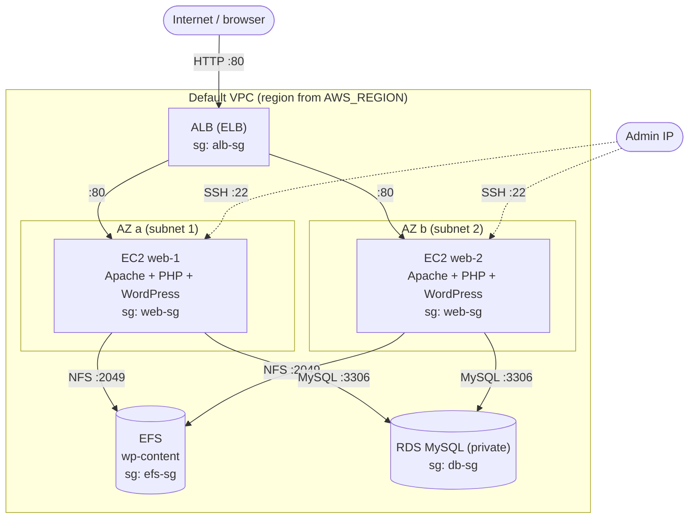

The system runs in the default VPC of the configured region. The region comes
from the `AWS_REGION` variable and otherwise falls back to the AWS CLI
profile's region, so each team member can deploy in their own account's
region; our run used Sydney (`ap-southeast-2`). We use two public subnets
in two different Availability Zones (AZs), because both the Application Load
Balancer and the RDS subnet group require at least two AZs, and spreading the
web servers across AZs means one AZ failure does not take the site down.

| Component | AWS service | Configuration |
|---|---|---|
| Load balancer | Elastic Load Balancing (Application Load Balancer) | Internet-facing, HTTP :80, spans both subnets |
| Web servers | EC2, 2 × `t3.micro`, Amazon Linux 2023 | One per AZ, Apache + PHP-FPM + WordPress |
| Database | RDS for MySQL, `db.t3.micro`, 20 GB gp3 | Single-AZ, not publicly accessible |
| Shared files | EFS, General Purpose, bursting throughput | Encrypted, one mount target per subnet |
| Access key | EC2 key pair (ed25519) | Private key kept locally in `.state/` |

WordPress keeps its state in two places: posts, users and settings in the
database, and uploaded media, themes and plugins in `wp-content`. To make the
two web servers interchangeable, both point at the same RDS database and both
mount the same EFS filesystem on `/var/www/html/wp-content`. They also share
the same authentication keys and salts in `wp-config.php`, so a login cookie
issued by one server is accepted by the other. As a result, it does not
matter which server the load balancer picks for a request.

### 2.1 Security groups

Each tier has its own security group, and each group only accepts traffic
from the tier directly in front of it. Only the load balancer is open to the
internet; the database and filesystem can only be reached from the web
servers.

| Security group | Attached to | Inbound rule |
|---|---|---|
| `lab01-wp-alb-sg` | Load balancer | TCP 80 from `0.0.0.0/0` |
| `lab01-wp-web-sg` | Both EC2 instances | TCP 80 from `alb-sg`; TCP 22 from the admin's public IP (/32) |
| `lab01-wp-efs-sg` | EFS mount targets | TCP 2049 (NFS) from `web-sg` |
| `lab01-wp-db-sg` | RDS instance | TCP 3306 (MySQL) from `web-sg` |

**What a security group does.** A security group is a stateful virtual
firewall attached to the network interface of a resource. All inbound traffic
is blocked unless a rule allows it, and replies to an allowed connection are
let back out automatically. A group has no effect until it is attached, so
the scripts attach each one when the resource is created: `--security-groups`
for the load balancer and the EFS mount targets, `--security-group-ids` for
the EC2 instances, and `--vpc-security-group-ids` for RDS.

**Why one group per component.** Each component needs a different port opened
to a different source (table above). This is least privilege: every component
opens only the port it serves, and only to the tier directly in front of it.

**Why not one shared group.** A single group attached to all four components
would have to hold every rule at once: port 80 from `0.0.0.0/0`, port 22 from
the admin IP, and ports 2049 and 3306 from the group itself. Every rule would
then apply to every member:

- The web servers would accept port 80 straight from the internet, so users
  could bypass the load balancer, along with its health checks and load
  spreading. If HTTPS were later added on the load balancer, those direct
  requests would still travel over plain HTTP.
- The database and the file system would accept connections from every
  member, the load balancer included, instead of only from the web servers.
- One tier's access could not be tightened without changing all of them.
- The configuration would no longer show which component is allowed to talk
  to which.

**Groups as rule sources.** With one group per tier, a rule can name another
group as its source; for example, `db-sg` allows port 3306 only from
`web-sg`. The rule follows the resources rather than their IP addresses: a
replaced or additional web server gets database access as soon as it carries
`web-sg`, with no rule changes. Together with RDS not being publicly
accessible, this protects the database in two layers.

## 3. Implementation

### 3.1 Project layout

| Path | Purpose |
|---|---|
| `Makefile` | Entry point, one target per step |
| `config.env` | Defaults: region, name prefix, instance sizes, DB name |
| `scripts/lib/common.sh` | Shared configuration, resource names, logging, waiting, and saving IDs to `.state/` |
| `scripts/00-network.sh` … `07-wordpress-install.sh` | One script per deployment step |
| `scripts/verify.sh`, `seed.sh`, `db-check.sh`, `status.sh`, `destroy.sh` | Checking, sample data, inspection, teardown |
| `wordpress/bootstrap.sh` | First-boot script run on each EC2 instance |

Each script saves the IDs it creates to `.state/resources.env`, and the next
script loads them. Passwords for the database and the WordPress admin, plus
the eight WordPress salts, are generated once with `openssl rand` and stored
in `.state/secrets.env`. The `.state/` directory is git-ignored.

### 3.2 Deployment steps

The diagram below shows everything we did, in order: deploy the stack with
`make up`, verify it, then delete it with `make destroy`. The dashed branch is
the bootstrap that runs in the background on each EC2 instance after it boots.

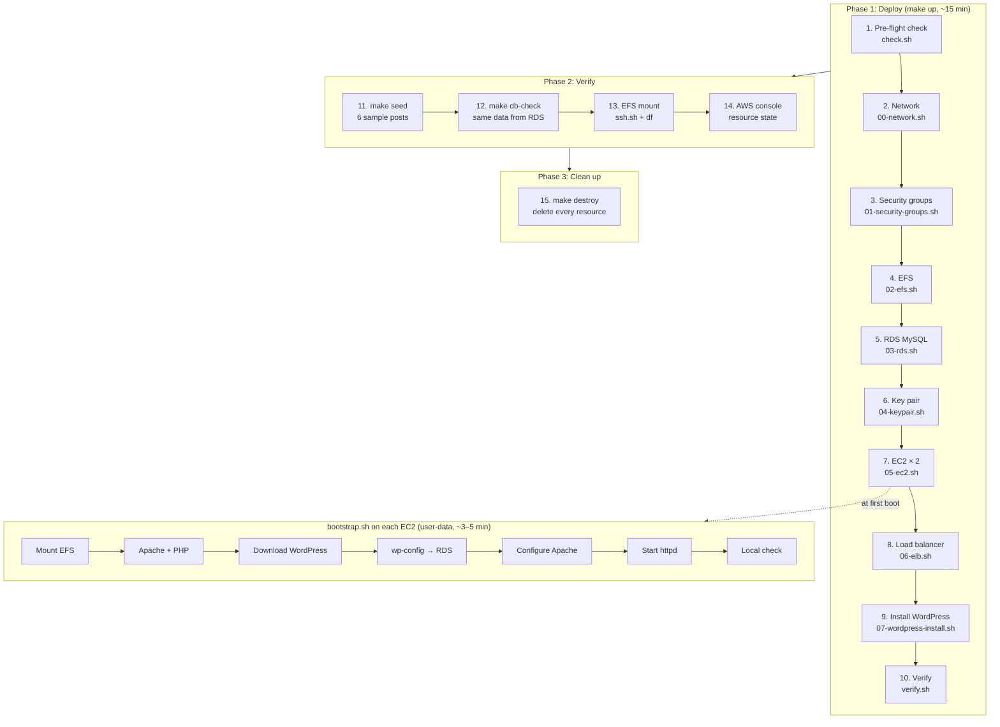

`make up` runs the following steps in order. The whole run takes about 15
minutes, most of it waiting for RDS.

1. **Pre-flight check** (`check.sh`). Confirms that `aws`, `curl`, `openssl`
   and `ssh` are installed, that the AWS credentials work, and that the
   account has read access to EC2, ELB, RDS, EFS and SSM in the region. This
   catches permission or region restrictions before anything is created.
2. **Network** (`00-network.sh`). Finds the default VPC and its first two
   default subnets, sorted by AZ, so they are always in different AZs.
3. **Security groups** (`01-security-groups.sh`). Creates the four groups and
   the rules in Section 2.1. The admin's public IP is detected automatically
   for the SSH rule.
4. **EFS** (`02-efs.sh`). Creates an encrypted filesystem and one mount target
   in each subnet, then waits until all mount targets are available.
5. **RDS** (`03-rds.sh`). Creates a DB subnet group over the two subnets and a
   MySQL `db.t3.micro` instance with `--no-publicly-accessible`, then waits
   for it and records its endpoint.
6. **Key pair** (`04-keypair.sh`). Creates an ed25519 key pair and saves the
   private key, which AWS only returns once.
7. **EC2** (`05-ec2.sh`). Looks up the latest Amazon Linux 2023 AMI through SSM,
   renders the user-data (configuration variables followed by
   `wordpress/bootstrap.sh`), and launches `web-1` and `web-2` in the two
   subnets with IMDSv2 required.
8. **Load balancer** (`06-elb.sh`). Creates a target group with a health check
   on `/` (accepting HTTP 200-399), registers both instances, creates the ALB
   across both subnets, and adds an HTTP :80 listener that forwards to the
   target group.
9. **WordPress install** (`07-wordpress-install.sh`). Waits until both targets
   are healthy, then submits the WordPress installation form
   (`/wp-admin/install.php?step=2`) through the ALB with the site title and
   admin account, and checks that the home page returns a title.
10. **Verify** (`verify.sh`). Sends several requests to the ALB and prints
    which server answered each one.

### 3.3 Web server bootstrap

Each instance runs `wordpress/bootstrap.sh` as user-data on first boot. It
logs to `/var/log/wordpress-bootstrap.log` and performs seven steps:

1. **Mount EFS.** Installs `amazon-efs-utils`, adds an entry with the `tls`
   and `_netdev` options to `/etc/fstab`, and mounts the filesystem on
   `/var/www/html/wp-content`, retrying while the mount target becomes
   reachable.
2. **Install Apache and PHP.** `httpd`, `php`, `php-fpm`, `php-mysqlnd`,
   `php-gd`, `php-mbstring`, `php-xml`, `php-opcache`.
3. **Download WordPress.** Fetches `https://wordpress.org/latest.tar.gz` and
   copies it into the web root. Because `wp-content` is shared, only one
   server should seed it. The script uses `mkdir` on EFS as a lock: the first
   server to create `.seed-lock` copies the default `wp-content`, and the
   other waits for the `.seeded` marker.
4. **Configure WordPress for RDS.** Writes `wp-config.php` with the RDS
   endpoint, database name, user, password and the shared salts.
5. **Configure Apache.** Enables `.htaccess` overrides and adds an
   `X-Served-By` response header containing the instance ID and AZ, read
   from the instance metadata service.
6. **Start services.** `systemctl enable --now php-fpm httpd`.
7. **Smoke test.** Requests `/wp-admin/install.php` locally until it returns
   HTTP 200.

### 3.4 Requirement mapping

| Requirement | Implementation |
|---|---|
| Create a load balancer (ELB) | `make elb` → `06-elb.sh` |
| Create a MySQL database (RDS) | `make rds` → `03-rds.sh` |
| Create a network filesystem (EFS) | `make efs` → `02-efs.sh` |
| Create and attach firewall rules | `make security-groups` → `01-security-groups.sh` |
| Create two virtual machines (EC2) | `make ec2` → `05-ec2.sh` |
| Mount the network filesystem | `bootstrap.sh` step 1 |
| Install Apache and PHP | `bootstrap.sh` step 2 |
| Download and extract the latest WordPress | `bootstrap.sh` step 3 |
| Configure WordPress to use RDS | `bootstrap.sh` step 4 |
| Start the web server | `bootstrap.sh` step 6 |
| Install the WordPress instance | `make install` → `07-wordpress-install.sh` |
| Access the WordPress instance | `make verify`, then open the ALB URL in a browser |

## 4. Verification

We check the deployment with three commands, each answering a different
question.

| Command | What it shows |
|---|---|
| `make verify` | The site is reachable through the ALB, and requests are spread over both servers (the `X-Served-By` header alternates between `web-1` and `web-2`). |
| `make seed` | Inserts six sample posts (`wordpress/seed-posts.tsv`) through WordPress's XML-RPC API, tagged `lab01-seed`. |
| `make db-check` | Reads the seeded posts back from each web server and prints RDS CloudWatch metrics (`WriteIOPS`, network throughput). Neither VM runs MySQL, so identical posts on both can only come from the shared RDS database. |

`make status` lists the state of every resource, and `make logs N=1` shows
the bootstrap log of a web server. In the browser, *wp-admin → Tools → Site
Health → Info → Database* shows the RDS endpoint as the database host.

### 4.1 Results

We ran `make up` in one member's AWS account in `ap-southeast-2`. The
pre-flight check confirmed access to EC2, ELB, RDS, EFS and SSM, and every
step then completed without errors. The main resources created were:

| Resource | ID / value |
|---|---|
| Default VPC | `vpc-0556a926ed973904f` |
| Subnet 1 (ap-southeast-2a) | `subnet-05d506a06d830aede` |
| Subnet 2 (ap-southeast-2b) | `subnet-015884ad9451019f5` |
| Security groups | `lab01-wp-alb-sg`, `lab01-wp-web-sg`, `lab01-wp-efs-sg`, `lab01-wp-db-sg` |
| EFS | `fs-00718aab6c5e7cef2`, one mount target per subnet |
| RDS MySQL endpoint | `lab01-wp-db.cd40yim44hyw.ap-southeast-2.rds.amazonaws.com` |
| AMI | `ami-013f66a12d3857f32` (Amazon Linux 2023, x86_64) |
| EC2 web-1 | `i-0b3f5245df51fe259` (ap-southeast-2a) |
| EC2 web-2 | `i-0c21c6990b227d5f6` (ap-southeast-2b) |
| Load balancer | `lab01-wp-alb-1596353679.ap-southeast-2.elb.amazonaws.com` |

Both targets became healthy, WordPress was installed through the load
balancer, and the home page returned the title "HCMUS Cloud Computing Lab 01".
The final `verify.sh` step sent eight requests to the load balancer. All eight
returned HTTP 200: web-1 (ap-southeast-2a) answered requests 1, 2, 5 and 7,
and web-2 (ap-southeast-2b) answered requests 3, 4, 6 and 8, so traffic was
split evenly across the two servers in two AZs.

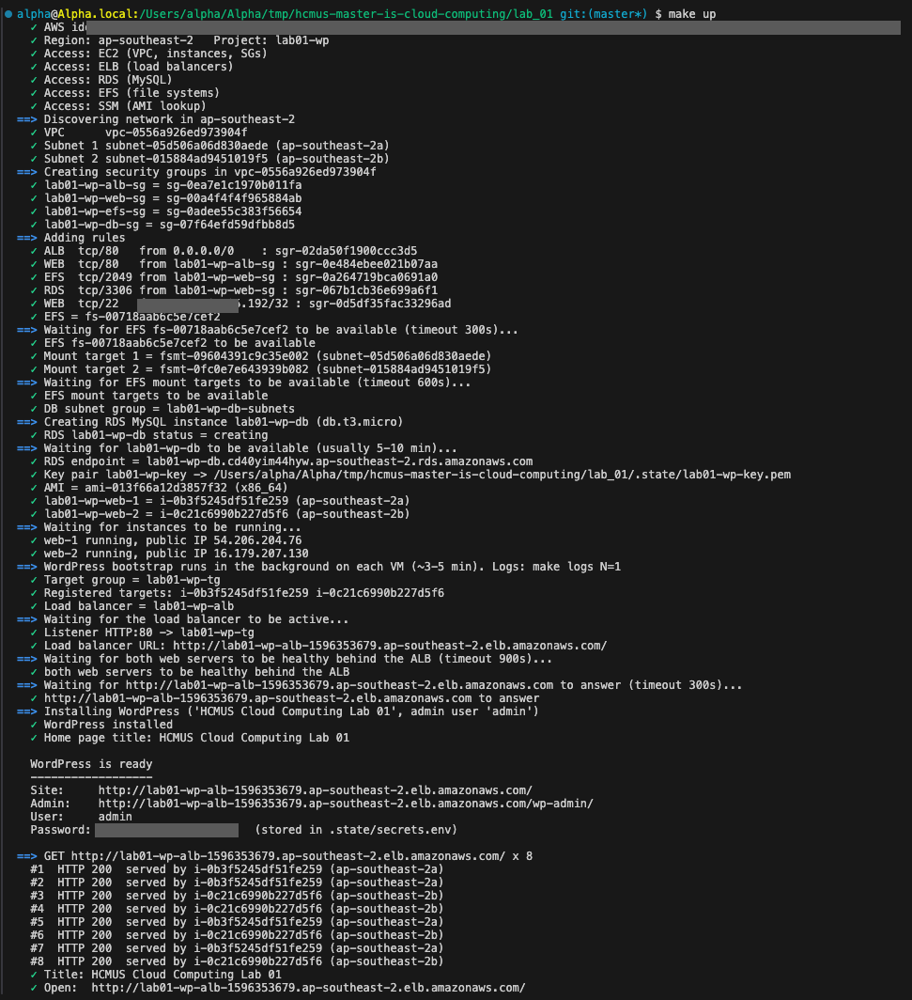

`make seed` then inserted six posts into the database through the XML-RPC
API (post IDs 5, 7, 9, 11, 13 and 15):

- [Lab 01] Lab 01: Architecture overview
- [Lab 01] Amazon RDS: the shared database
- [Lab 01] Amazon EFS: shared uploads
- [Lab 01] Elastic Load Balancing
- [Lab 01] Security groups
- [Testing] Seed data check

The WordPress home page, opened through the load balancer URL, lists these
posts.

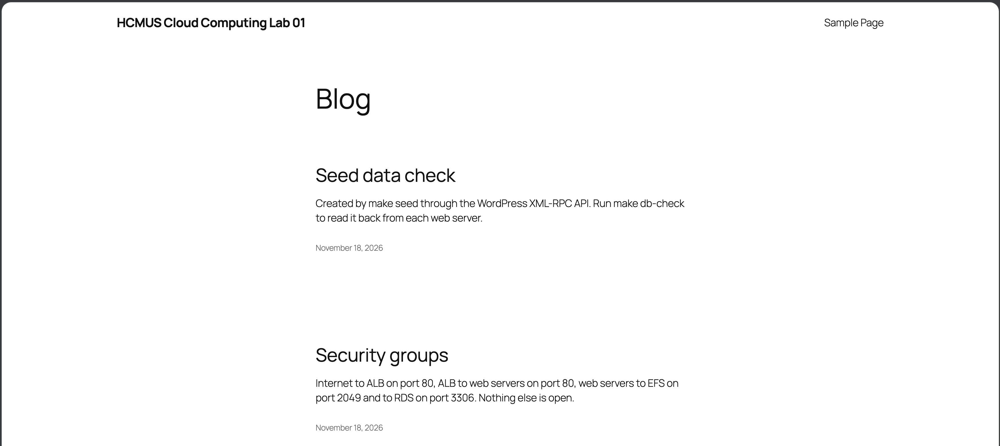
 Logging in to wp-admin as `admin` also worked: the Posts screen lists
seven posts, the six tagged `lab01-seed` plus WordPress's default
"Hello world!" post (WordPress 7.1.4).

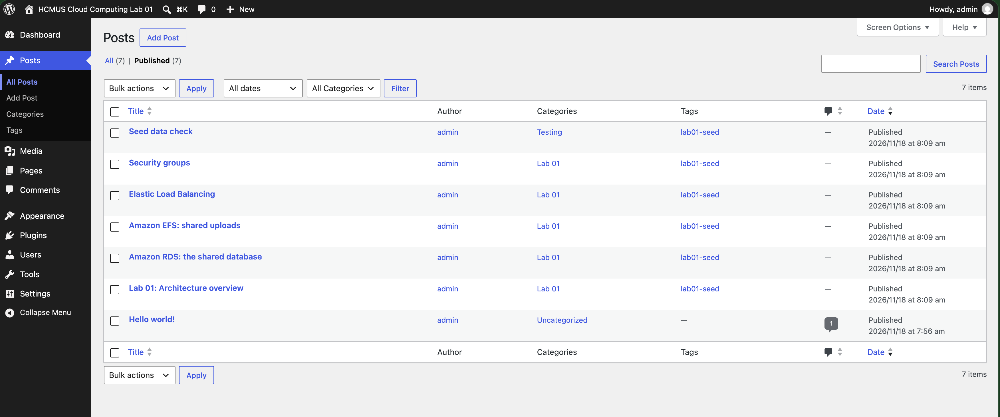

Finally, `make db-check` confirmed that WordPress uses RDS. The RDS endpoint
runs MySQL 8.4.11. Read directly from each web server, both
`i-0b3f5245df51fe259` (web-1) and `i-0c21c6990b227d5f6` (web-2) returned the
same six seeded posts. Neither web server runs MySQL, so identical data on
both can only come from the shared RDS database.

The RDS CloudWatch metrics for the last 30 minutes also show activity from
the web servers: `WriteIOPS` peaked at 245.7, `NetworkReceiveThroughput` at
227,596 bytes/s and `NetworkTransmitThroughput` at 67,212.5 bytes/s.

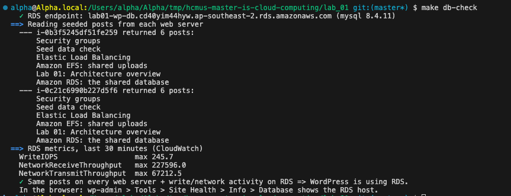

The AWS console confirms the state of each resource after deployment:

- Both EC2 instances, `lab01-wp-web-1` and `lab01-wp-web-2` (t3.micro), are
  running in ap-southeast-2a and ap-southeast-2b with 3/3 status checks passed.

  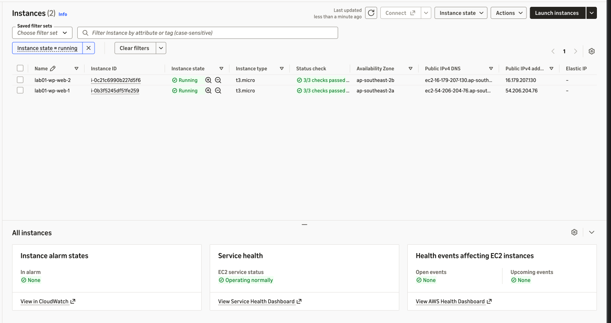
- The four lab security groups sit in `vpc-0556a926ed973904f`, next to the
  VPC's `default` group.

  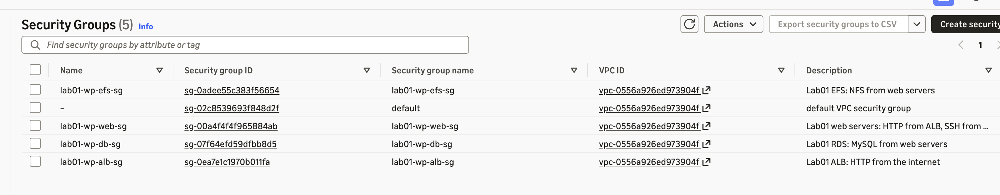
- The load balancer `lab01-wp-alb` is Active: application type,
  internet-facing, two Availability Zones, security group `lab01-wp-alb-sg`.

  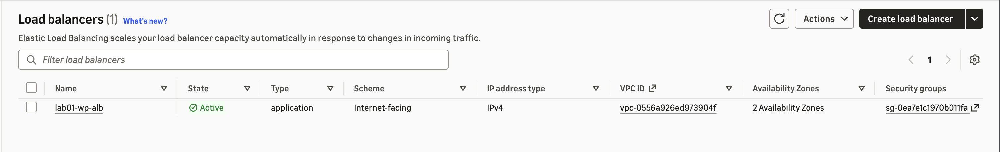
- The database `lab01-wp-db` (MySQL Community, db.t3.micro) is Available in
  ap-southeast-2b, with the internet access gateway disabled. It shows 0
  connections because WordPress only connects while it handles a request.

  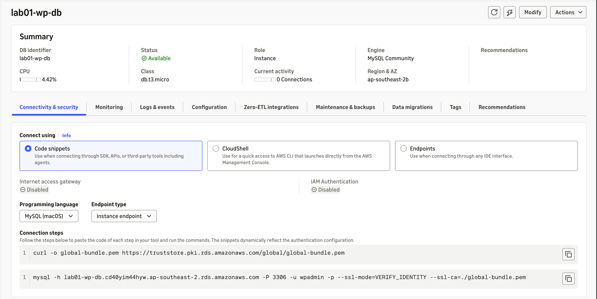
- The file system `lab01-wp-efs` (`fs-00718aab6c5e7cef2`) is Available, in
  General Purpose performance mode with bursting throughput, and encrypted
  with the `aws/elasticfilesystem` key.

  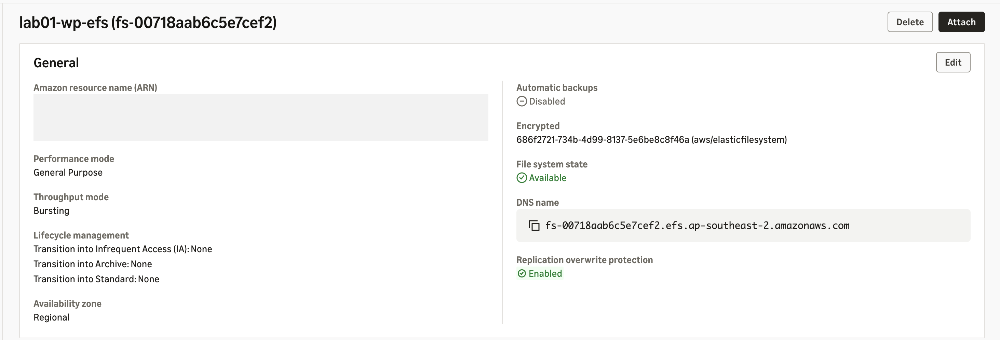

On each web server, `df` shows `/var/www/html/wp-content` mounted as `nfs4`
with a size of `8.0E`, which is EFS rather than a local disk. The source
appears as `127.0.0.1:/` because the `tls` option sends NFS traffic through a
local encrypted tunnel; the `/etc/fstab` line confirms it is
`fs-00718aab6c5e7cef2`. Both servers see the same `.seed-lock` and `.seeded`
files, which only one of them created, so `wp-content` really is shared.

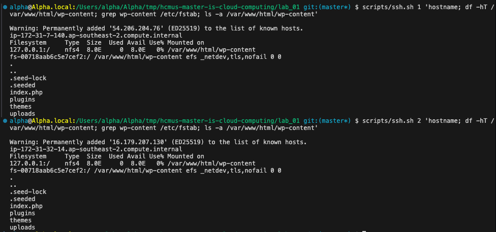

## 5. Discussion

**Why the setup works with two servers.** A WordPress server is only
stateless if its state lives somewhere shared. Moving the database to RDS,
`wp-content` to EFS, and using identical salts is what allows the load
balancer to send any request to any server without breaking logins or
uploads.

**Security.** The database and filesystem are not reachable from the
internet, and SSH is limited to the admin's IP. EFS traffic is encrypted in
transit (`tls` mount option) and the filesystem is encrypted at rest. The
instances require IMDSv2 tokens for metadata access.

**Limitations.** These choices are acceptable for a lab but not for
production:

- The site uses plain HTTP; there is no domain or TLS certificate on the ALB.
- The database password and salts are passed through EC2 user-data, which
  anyone with `ec2:DescribeInstanceAttribute` can read. AWS Secrets Manager
  or SSM Parameter Store would be the proper place for them.
- RDS runs in a single AZ with backups disabled, so the database is a single
  point of failure.
- The web servers sit in public subnets with public IPs (needed here for SSH
  and package downloads). Production would place them in private subnets
  behind a NAT gateway.
- There is no Auto Scaling group; a failed instance has to be replaced by
  hand (`make ec2 elb`).

**Cost.** The ALB, RDS instance, EFS and both EC2 instances are billed by
the hour, and only part of this is covered by the free tier. We remove
everything with `make destroy` after each session.

## 6. Conclusion

We deployed WordPress on AWS with a load balancer, two web servers in
different Availability Zones, a managed MySQL database and a shared network
filesystem, covering every item in the lab requirements. Scripting the
deployment with the AWS CLI took more effort up front than using the console,
but it gave us a setup we can rebuild and tear down on demand, and a precise
record of how each component is configured and connected.

## References

1. Amazon Web Services. *What is an Application Load Balancer?* Elastic Load
   Balancing documentation.
   <https://docs.aws.amazon.com/elasticloadbalancing/latest/application/introduction.html>
2. Amazon Web Services. *Amazon RDS for MySQL.* Amazon RDS User Guide.
   <https://docs.aws.amazon.com/AmazonRDS/latest/UserGuide/CHAP_MySQL.html>
3. Amazon Web Services. *Mounting EFS file systems using the EFS mount
   helper.* Amazon EFS User Guide.
   <https://docs.aws.amazon.com/efs/latest/ug/efs-mount-helper.html>
4. Amazon Web Services. *Run commands on your Linux instance at launch (user
   data).* Amazon EC2 User Guide.
   <https://docs.aws.amazon.com/AWSEC2/latest/UserGuide/user-data.html>
5. Amazon Web Services. *Control traffic to your AWS resources using security
   groups.* Amazon VPC User Guide.
   <https://docs.aws.amazon.com/vpc/latest/userguide/vpc-security-groups.html>
6. WordPress.org. *Editing wp-config.php.* WordPress Developer Resources.
   <https://developer.wordpress.org/advanced-administration/wordpress/wp-config/>
